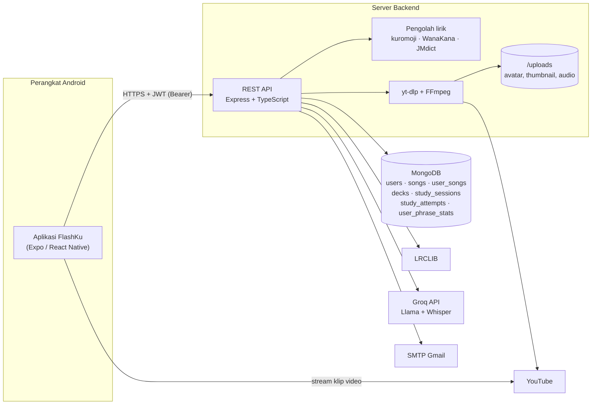
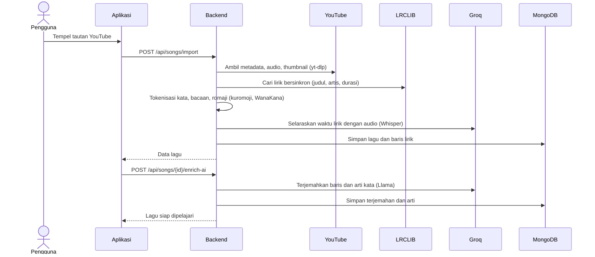
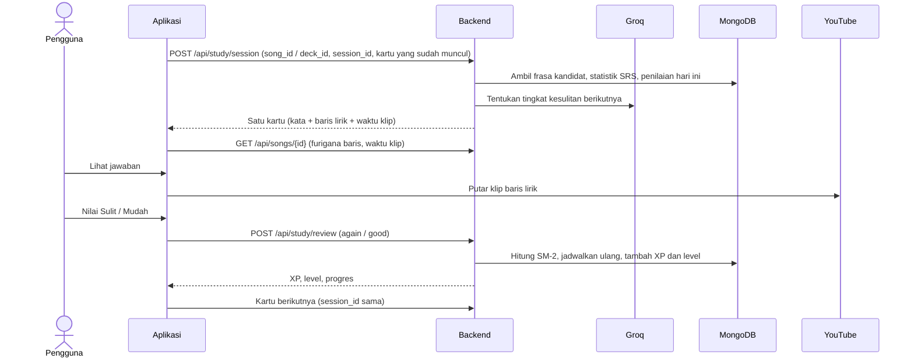

# FlashKu

Belajar kosakata bahasa Jepang dari lagu YouTube favoritmu, lewat flashcard yang dibuat otomatis dari liriknya.

|                   |                                                                                                     |
| ----------------- | --------------------------------------------------------------------------------------------------- |
| **Kategori**      | Mobile (Android)                                                                                    |
| **Nama aplikasi** | FlashKu                                                                                             |
| **API (deploy)**  | https://flashku.dewayani.web.id/api · dokumentasi Swagger: https://flashku.dewayani.web.id/api/docs |

---

## Tim

**Nama tim:** [Nama Tim]

| Nama                          | Peran                           |
| ----------------------------- | ------------------------------- |
| Putra Pangestu Wibisono       | Product Manager, UI/UX Designer |
| Rakha Ariqah Wijaya           | Frontend Developer              |
| Ardiansyah Dhevashidqi Madany | Backend Developer, AI Engineer  |

---

## Masalah, solusi, dan target pengguna

### Masalah

- Banyak orang tertarik belajar bahasa Jepang karena anime dan J-pop, tetapi menghafal kosakata dari buku atau daftar kata terasa kering dan cepat terlupa.
- Membuat flashcard sendiri dari lirik lagu memakan waktu: lirik harus dicari, kata dipisah satu per satu, bacaan (furigana) dan arti dicari manual, lalu dicocokkan dengan bagian lagunya.
- Kosakata yang dipelajari tanpa konteks (kalimat dan suara aslinya) lebih sulit diingat dan diucapkan.

### Solusi

FlashKu mengubah tautan lagu YouTube menjadi dek flashcard secara otomatis:

1. Pengguna menempelkan tautan YouTube.
2. Server mengambil lirik bersinkron waktu, memecahnya menjadi kata (tokenisasi bahasa Jepang), menambahkan bacaan dan romaji, lalu menerjemahkan baris dan arti kata ke bahasa Indonesia dengan AI.
3. Setiap kata menjadi kartu. Saat jawaban dibuka, aplikasi memutar potongan video tepat pada baris lirik tempat kata itu muncul, jadi kata dipelajari bersama kalimat dan suaranya.
4. Penjadwalan ulang memakai spaced repetition (SM-2), dan pemilihan kartu disesuaikan dengan performa belajar hari itu.

### Target pengguna

- Pelajar dan mahasiswa Indonesia yang belajar bahasa Jepang tingkat pemula hingga menengah.
- Penggemar anime dan J-pop yang ingin memahami lirik lagu yang mereka dengarkan.
- Pembelajar mandiri yang ingin belajar singkat tapi rutin (sesi beberapa menit per hari).

---

## Fitur utama yang sudah diimplementasikan

**Akun**

- Daftar akun dengan verifikasi email lewat kode OTP.
- Masuk dengan username atau email.
- Profil: ganti username, unggah dan hapus avatar, ganti kata sandi.

**Lagu**

- Impor lagu dari tautan YouTube: lirik bersinkron (LRCLIB), tokenisasi kata, romaji, serta terjemahan baris dan arti kata dengan AI.
- Daftar lagu dengan pencarian, filter favorit, dan pilih banyak.
- Menu tekan-lama: tambah ke deck, salin tautan asli, ulangi terjemahan AI, hapus lagu.

**Deck**

- Kelompokkan lagu ke dalam deck, dengan thumbnail kolase dari lagu di dalamnya.
- Lihat isi deck, keluarkan lagu dari deck, ganti nama, dan hapus deck.

**Belajar**

- Flashcard soal dan jawaban: kata besar, bacaan hiragana, arti, kalimat lirik dengan furigana, dan terjemahannya.
- Klip video dipotong tepat pada baris lirik, dengan fade in/out, kecepatan 0,5x–1,25x, dan geser waktu klip.
- Penilaian dua tingkat (Sulit dan Mudah) dengan spaced repetition SM-2 di server.
- Pemilihan kartu adaptif: tingkat kesulitan kata disesuaikan dengan penilaian hari itu, dan baris lirik yang baru diputar tidak diulang.
- Belajar per lagu, per deck, atau semua lagu sekaligus.
- Opsi tampilkan romaji di kartu jawaban.

**Progres**

- XP dan level, dengan bar progres menuju level berikutnya.
- Beranda: level, jumlah kosakata unik di perpustakaan, jumlah lagu, dan tombol lanjutkan belajar.

**Lainnya**

- Pengingat belajar lewat notifikasi lokal (harian atau mingguan, dengan mode senyap). Pengaturannya masih disimpan di perangkat.
- Tema terang, gelap, atau mengikuti sistem.

---

## Teknologi

### Frontend (`frontend/`)

| Kategori          | Teknologi                                                                                      |
| ----------------- | ---------------------------------------------------------------------------------------------- |
| Framework         | Expo SDK 58, React Native 0.88, React 19, TypeScript, Expo Router (routing berbasis file)      |
| Data dan state    | TanStack Query v5, Axios                                                                       |
| Form dan validasi | react-hook-form, Zod                                                                           |
| UI dan animasi    | React Native Reanimated 4, Expo Image, @expo/vector-icons (Ionicons), font Plus Jakarta Sans   |
| Media             | expo-video (pemutar klip)                                                                      |
| Perangkat         | expo-secure-store (token), expo-notifications, expo-image-picker, expo-clipboard, AsyncStorage |
| Build             | EAS Build (APK Android)                                                                        |
| Paket             | Bun                                                                                            |

### Backend (`backend/`)

| Kategori                 | Teknologi                                                   |
| ------------------------ | ----------------------------------------------------------- |
| Framework                | Node.js, Express 5, TypeScript                              |
| Database                 | MongoDB (driver resmi `mongodb`)                            |
| Autentikasi              | JWT (`jsonwebtoken`), bcrypt                                |
| Email                    | Nodemailer (SMTP)                                           |
| Unggah file              | Multer                                                      |
| Pengolahan bahasa Jepang | kuromoji.js (tokenisasi), WanaKana (romaji), JMdict (kamus) |
| Audio dan video          | yt-dlp, FFmpeg (`ffmpeg-static`)                            |
| Dokumentasi API          | Swagger UI                                                  |

### API dan layanan pihak ketiga

| Layanan                          | Kegunaan                                                                                                                                            |
| -------------------------------- | --------------------------------------------------------------------------------------------------------------------------------------------------- |
| YouTube                          | Sumber video dan audio lagu, thumbnail, metadata (oEmbed)                                                                                           |
| LRCLIB (`lrclib.net`)            | Lirik bersinkron waktu (format LRC)                                                                                                                 |
| Groq API                         | LLM Llama 3.3 70B / Llama 3.1 8B untuk terjemahan, arti kata, dan keputusan tingkat kesulitan; Whisper untuk menyelaraskan waktu lirik dengan audio |
| JMdict (via `jmdict-simplified`) | Kamus Jepang–Inggris yang disimpan lokal di server                                                                                                  |
| SMTP (Gmail)                     | Pengiriman kode OTP                                                                                                                                 |

---

## Arsitektur sistem



### Alur data: impor lagu



### Alur data: sesi belajar



---

## Instalasi dan menjalankan aplikasi

### Prasyarat

- Node.js versi LTS dan npm (backend)
- Bun (frontend)
- MongoDB (lokal atau MongoDB Atlas)
- Akun Groq dan API key: https://console.groq.com/keys
- Akun email untuk SMTP. Untuk Gmail, gunakan _App Password_.
- Perangkat Android, atau emulator Android dengan development build

### 1. Backend

```bash
cd backend
npm install
cp .env.example .env      # lalu isi nilainya, lihat tabel variabel di bawah
npm run setup:dict        # unduh kamus JMdict ke backend/data/jmdict
npm run dev               # mode pengembangan, http://127.0.0.1:5000
```

Untuk produksi:

```bash
npm run build
npm start
```

- Dokumentasi API tersedia di `http://127.0.0.1:5000/api/docs` dan cek kesehatan di `/api/health`.
- **yt-dlp:** binari diunduh otomatis dari rilis GitHub yt-dlp bila belum ada. Kalau sudah terpasang, arahkan lewat `YT_DLP_PATH`.
- **Cookie YouTube (opsional):** server di pusat data kadang diblokir YouTube ("Sign in to confirm you're not a bot"). Isi salah satu dari `YOUTUBE_COOKIES_BASE64`, `YOUTUBE_COOKIES_TEXT`, atau `YOUTUBE_COOKIE_FILE` dengan cookie format Netscape.
- **Proxy AI (opsional):** bila Groq diblokir di wilayah server, isi `GROQ_PROXY` atau `AI_PROXY`.

### 2. Frontend

```bash
cd frontend
bun install
cp .env.example .env      # isi EXPO_PUBLIC_API_URL
```

Aplikasi memakai modul native (`expo-video`, `expo-secure-store`, `expo-notifications`), jadi gunakan **development build**, bukan Expo Go:

```bash
bunx eas-cli login
bunx eas-cli build --platform android --profile development   # pasang APK dev di HP
bunx expo start --dev-client                                  # jalankan Metro
```

Membuat APK untuk dibagikan atau dinilai:

```bash
bunx eas-cli build --platform android --profile preview
```

- Profil `preview` di `frontend/eas.json` sudah berisi `EXPO_PUBLIC_API_URL` server deploy. Ubah nilainya bila memakai server sendiri.
- Untuk emulator Android yang terhubung ke backend lokal, pakai `http://10.0.2.2:5000/api`. Untuk HP di jaringan yang sama, pakai `http://<IP-LAN-komputer>:5000/api`.

### Variabel lingkungan

#### `backend/.env`

| Variabel                                                                  | Wajib | Keterangan                                                    |
| ------------------------------------------------------------------------- | ----- | ------------------------------------------------------------- |
| `PORT`                                                                    | –     | Port server (bawaan `5000`)                                   |
| `APP_URL`                                                                 | ya    | URL publik server, dipakai untuk URL file `/uploads`          |
| `BASE_URL`                                                                | –     | Alternatif `APP_URL`                                          |
| `DB_URL`                                                                  | ya    | Connection string MongoDB                                     |
| `JWT_SECRET`                                                              | ya    | Rahasia penandatangan JWT (string acak panjang)               |
| `JWT_EXP`                                                                 | –     | Masa berlaku token (bawaan `1d`)                              |
| `MAIL_HOST`, `MAIL_PORT`                                                  | ya    | Server SMTP, mis. `smtp.gmail.com` dan `587`                  |
| `MAIL_USERNAME`, `MAIL_PASSWORD`                                          | ya    | Akun pengirim OTP (Gmail: App Password)                       |
| `MAIL_ENCRYPTION`                                                         | –     | `tls`                                                         |
| `GROQ_API_KEY`                                                            | ya    | API key Groq untuk terjemahan, kesulitan adaptif, dan Whisper |
| `GROQ_MODEL`                                                              | –     | Bawaan `llama-3.3-70b-versatile`                              |
| `GROQ_BASE_URL`                                                           | –     | Endpoint Groq kustom                                          |
| `GROQ_PROXY` / `AI_PROXY` / `HTTPS_PROXY` / `HTTP_PROXY`                  | –     | Proxy untuk permintaan AI                                     |
| `YT_DLP_PATH`                                                             | –     | Lokasi binari yt-dlp                                          |
| `YOUTUBE_COOKIES_BASE64` / `YOUTUBE_COOKIES_TEXT` / `YOUTUBE_COOKIE_FILE` | –     | Cookie YouTube bila server diblokir                           |
| `YOUTUBE_USER_AGENT`                                                      | –     | User agent kustom untuk yt-dlp                                |

Contoh lengkap ada di [`backend/.env.example`](backend/.env.example).

#### `frontend/.env`

| Variabel                           | Wajib | Keterangan                                                             |
| ---------------------------------- | ----- | ---------------------------------------------------------------------- |
| `EXPO_PUBLIC_API_URL`              | ya    | URL API termasuk `/api`, mis. `https://flashku.dewayani.web.id/api`    |
| `EXPO_PUBLIC_GOOGLE_WEB_CLIENT_ID` | –     | Untuk login Google. Fitur ini belum aktif dan tombolnya disembunyikan. |

Variabel `EXPO_PUBLIC_*` ikut terbawa ke dalam aplikasi, jadi jangan mengisinya dengan rahasia. Contoh ada di [`frontend/.env.example`](frontend/.env.example).

---

## Akun demonstrasi

| Email                         | Kata sandi    |
| ----------------------------- | ------------- |
| `25032014057@mhs.unesa.ac.id` | `IniAkunDemo` |

Pengguna juga bisa mendaftar akun baru. Kode OTP verifikasi dikirim ke email yang didaftarkan.

---

## Dokumentasi penggunaan AI

AI dipakai **di dalam aplikasi** melalui Groq API, seluruhnya di sisi server:

| Kegunaan                                            | Model                                  | Masukan → Keluaran                                                                     |
| --------------------------------------------------- | -------------------------------------- | -------------------------------------------------------------------------------------- |
| Terjemahan baris lirik dan arti kata sesuai konteks | Llama 3.3 70B (cadangan: Llama 3.1 8B) | Baris lirik Jepang dan daftar kata → terjemahan Indonesia per baris dan arti tiap kata |
| Terjemahan arti kamus JMdict (Inggris → Indonesia)  | Llama 3.3 70B                          | Arti bahasa Inggris dari JMdict → arti bahasa Indonesia, disimpan sebagai cache        |
| Tingkat kesulitan kartu adaptif                     | Llama 3.3 70B                          | Level pengguna dan penilaian hari ini → rentang bobot kata untuk kartu berikutnya      |
| Penyelarasan waktu lirik                            | Whisper (Groq)                         | Audio lagu → teks bertimestamp untuk mengoreksi waktu baris lirik                      |

Batasan dan penanganannya:

- Hasil AI bisa keliru. Pengguna bisa menjalankan ulang terjemahan lewat menu lagu ("Ulangi terjemahan AI") dan menggeser waktu klip secara manual.
- Bila AI tidak tersedia (kuota habis atau timeout), server memakai cadangan: arti bahasa Inggris dari kamus JMdict untuk arti kata, dan perhitungan heuristik dari penilaian hari itu untuk tingkat kesulitan.
- Data yang dikirim ke Groq hanya teks lirik, daftar kata, audio lagu, level pengguna, dan ringkasan penilaian hari itu. Email, nama, dan kata sandi tidak dikirim.

---

## Atribusi

| Sumber                                                                                                                                       | Dipakai untuk                    | Lisensi / ketentuan                                                          |
| -------------------------------------------------------------------------------------------------------------------------------------------- | -------------------------------- | ---------------------------------------------------------------------------- |
| [Expo](https://expo.dev) `create-expo-app`                                                                                                   | Template awal frontend           | MIT ([`frontend/LICENSE`](frontend/LICENSE))                                 |
| [Plus Jakarta Sans](https://fonts.google.com/specimen/Plus+Jakarta+Sans) via `@expo-google-fonts`                                            | Huruf antarmuka                  | SIL Open Font License 1.1                                                    |
| [Ionicons](https://ionic.io/ionicons) via `@expo/vector-icons`                                                                               | Ikon antarmuka                   | MIT                                                                          |
| [JMdict / EDICT](https://www.edrdg.org/wiki/index.php/JMdict-EDICT_Dictionary_Project), Electronic Dictionary Research and Development Group | Kamus arti kata                  | CC BY-SA 4.0                                                                 |
| [jmdict-simplified](https://github.com/scriptin/jmdict-simplified)                                                                           | Format JSON JMdict               | CC BY-SA 4.0 (data)                                                          |
| [LRCLIB](https://lrclib.net)                                                                                                                 | Lirik bersinkron                 | API publik gratis; lirik milik pemegang hak cipta masing-masing              |
| YouTube                                                                                                                                      | Video, audio, dan thumbnail lagu | Konten milik pemiliknya masing-masing; dipakai hanya untuk keperluan belajar |
| [kuromoji.js](https://github.com/takuyaa/kuromoji.js)                                                                                        | Tokenisasi bahasa Jepang         | Apache 2.0                                                                   |
| [WanaKana](https://github.com/WaniKani/WanaKana)                                                                                             | Konversi kana dan romaji         | MIT                                                                          |
| [yt-dlp](https://github.com/yt-dlp/yt-dlp)                                                                                                   | Pengunduhan audio dan metadata   | Unlicense                                                                    |
| [FFmpeg](https://ffmpeg.org) via `ffmpeg-static`                                                                                             | Pengolahan audio                 | LGPL/GPL (binari FFmpeg)                                                     |
| [Groq](https://groq.com)                                                                                                                     | Inferensi Llama dan Whisper      | Ketentuan layanan Groq; model mengikuti lisensi Llama dan Whisper            |
| Logo dan ikon aplikasi FlashKu                                                                                                               | Ikon aplikasi dan layar pembuka  | [Sumber atau pembuat logo]                                                   |

Pustaka open source lain yang dipakai beserta lisensinya tercantum di `frontend/package.json` dan `backend/package.json`.
